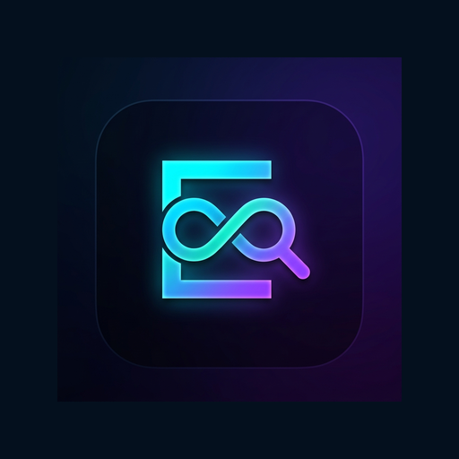

<div align="center">
  

  <h1>Everything Launcher</h1>

  <p><strong>A fast, minimalist, and truly universal Android launcher.</strong></p>

  <div>
    <a href="https://developer.android.com/about/versions/pie"></a>
    <a href="https://github.com/zakir786lrk/Everything-launcher-/releases"></a>
    <a href="https://kotlinlang.org/"></a>
    <a href="https://developer.android.com/jetpack/compose"></a>
    <a href="LICENSE"></a>
  </div>

  <p>Everything Launcher brings together lightning-fast universal search, an integrated Google News feed, smart contact actions, an auto-centering bottom dock with the Everything action button, and deep personalization—completely free of ads and telemetry.</p>
</div>

---

## 🌟 Features

### 🔍 Spotlight Universal Search
- **Instant App Search & A-Z Rail**: Rapidly search installed applications or swipe through the alphabet rail for instant alphabetical navigation.
- **Live Math & Percentage Calculator**: Perform calculations on the fly directly in the search bar (e.g., `15% of 250`, `20% off 80`, `(45 * 12) / 3`) with one-tap copy.
- **Device Settings Shortcuts**: Search and jump directly into Android system settings (Wi-Fi, Bluetooth, Hotspot, Display, Battery, Sound, Storage, Developer Options, and more).
- **AI & Web Search Forwarding**: Tap quick-access chips to forward queries to AI engines (**ChatGPT**, **Gemini**, **Perplexity**, **Claude**) and search platforms (**Google**, **DuckDuckGo**, **YouTube**, **Wikipedia**, **Reddit**, **GitHub**, **Play Store**, **Maps**, **Amazon**, **Brave**).
- **Live Autocomplete**: Real-time web search suggestions powered by Google Suggest.
- **Dynamic App Sections**: Optional quick sections for **Recently Opened**, **Frequently Opened**, and **Recently Installed** apps.

### 📰 Swipe-to-Read Newsfeed (Google News)
- **Built-in News Screen**: Swipe left to open a distraction-free newsfeed designed to blend seamlessly with your launcher's theme.
- **Worldwide Coverage**: Choose your local news edition from countries and regions across the globe.
- **Topic Filters**: Easily switch between **Top Stories**, **World**, **Business**, **Technology**, **Entertainment**, **Sports**, **Science**, and **Health**.
- **Integrated Search & Weather**: Search the web or check current weather conditions directly from the feed screen.

### 📞 Contact Quick Actions
- **Direct Calling & SMS**: Search for contacts and instantly place phone calls or open message threads with dedicated action buttons right on the search card.

### 📱 Centered Bottom Dock & Everything Button
- **Fixed Home Dock**: Pin your favorite app stacks to the bottom as an auto-fitting, centered dock.
- **Everything Button**: A versatile action button that sits floating or integrates right into the bottom dock.
- **Custom Gestures**: Assign unique shortcuts to Tap, Double-Tap, Long-Press, Swipe-Up, and Swipe-Down on the Everything Button.

### 🎨 Personalization & Design
- **Icon Designer**: Customize icon shapes, sizes, colors, and letter fallbacks for unthemed apps.
- **Custom Clock Widget**: Style your home screen clock with custom typography, date layouts, and weather integration.
- **Material You**: Dynamic wallpaper-based color palettes with full Dark and AMOLED black modes.
- **Favorites Overflow**: Choose between scrollable favorites or automatically moving extra home apps into a dedicated "More" folder.
- **Wallpaper Dimming**: Adjustable wallpaper dimming for enhanced text contrast and focus.

### 💾 Backup & Restore
- **Portable JSON Backups**: Export your entire launcher configuration—including home layouts, favorite apps, custom icons, and preferences—to a timestamped JSON file.
- **One-Tap Restore**: Restore your setup instantly across devices or fresh installations.

### 🔒 100% Privacy
- **Zero ads, zero telemetry, zero analytics.**
- All searches and launcher configurations are processed strictly on your device.
- External connections are made solely for user-initiated web searches, Google Suggest autocompletion, and Google News RSS feeds.

---

## 📥 Download

Pre-compiled APKs are available on GitHub:
- **Latest Release**: Download from [GitHub Releases](https://github.com/zakir786lrk/Everything-launcher-/releases) or the latest [GitHub Actions](https://github.com/zakir786lrk/Everything-launcher-/actions) build artifact.
- **System Requirements**: Android 9.0 (API 28) or higher.

---

## 🛠️ Building from Source

To build Everything Launcher locally:

1. Ensure **OpenJDK 21** and the **Android SDK (API 35+)** are installed.
2. Clone the repository and build:

```bash
git clone https://github.com/zakir786lrk/Everything-launcher-.git
cd Everything-launcher-

# Build the Release APK
./gradlew :app:assembleRelease

# Or build the Debug APK
./gradlew :app:assembleDebug
```

Compiled APKs are output to:
- Release: `app/build/outputs/apk/release/app-release.apk`
- Debug: `app/build/outputs/apk/debug/app-debug.apk`

---

## 🤝 Acknowledgements & Credits

Everything Launcher is built upon and inspired by the work of the open-source community:

1. **[Grace Launcher](https://github.com/Galaxy-rio/GraceLauncher)** by **[Galaxy-rio](https://github.com/Galaxy-rio)**
   - The foundation of this launcher. Provided the clean list-based home layout, gesture system, app stacks, clock widget designer, and Jetpack Compose architecture.
2. **[Quick Search](https://github.com/teja2495/quick-search)** by **[Teja Karlapudi (teja2495)](https://github.com/teja2495)**
   - Inspired the universal spotlight search experience, device settings indexing, math/percentage calculator engine, Google suggestion integration, and search target chips.
3. **[Scout](https://github.com/ssjrocks/scout)** by **[Shashank (ssjrocks)](https://github.com/ssjrocks)**
   - Inspired the swipe-accessible Google News RSS feed screen with worldwide region selection and topic browsing.

---

## 📄 License

This project is licensed under the **GNU General Public License v3.0** (GPLv3). See the [LICENSE](LICENSE) file for details.
